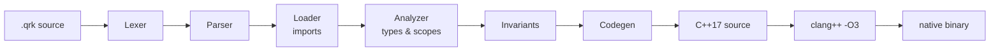

# Quark

Quark is a small, dynamically-typed programming language that compiles to native
binaries. You write code that reads like a scripting language; the Quark compiler
translates it to C++17, hands it to `clang++`, and produces a fast standalone
executable.

This README is a hands-on onboarding guide: install the compiler, run your first
program, and learn the language feature by feature with examples you can paste and
run. Every code sample here was run against the current compiler.

> **Maturity note.** Quark is an early, actively-developed project. The core
> language (functions, closures, control flow, pattern matching, lists, dicts,
> vectors, and structs) works today.

> **AI note:** Large chunks of the compiler are written using AI assistance. Please use it at your risk, feel free to file issues for bugs.

## Language features overview

Quark aims to feel like a scripting language for data work while compiling to fast
native code.

### Two collections: lists and vectors
- A **list** is a general container. It holds values of any type, nests, and can
  be changed in place (`push`, `insert`, `xs[i] = v`). Use it for records, rows,
  mixed data, and lists of other collections.
- A **vector** is one typed column of data: all `int`, all `float`, all `bool`
  or all `str`, with nulls allowed. Vectors can't be changed in place, and
  every operation returns a new vector. Arithmetic and comparisons apply to every
  element at once, and a boolean vector filters another vector.

```quark
// A list holds anything: here, one CSV row
row = list ['Pune', 31.5, true]
row.push(list [1, 2])            // lists nest and grow in place
println(len(row))                // 4

// A vector is one typed column
temps = vector [31.5, 29.0, 33.1, 38.2]
println(type(temps))             // vector[f64]
fahrenheit = temps * 1.8 + 32.0  // element-wise, no loop
hot = temps[temps > 30.0]        // filter with a boolean mask
println(max(hot))                // 38.2
```

Keeping the two apart lets each one be good at its job. A list doesn't have to
be fast at arithmetic, and a vector doesn't have to hold arbitrary values. That
is what makes the next point possible.

### Vectors use the Apache Arrow memory layout

Vector buffers follow the Apache Arrow columnar format:

- `f64` and `i64` are contiguous arrays of `double` / `int64_t`.
- `bool` is bit-packed.
- `str` is `int32` offsets plus one UTF-8 byte buffer.
- Nulls are an Arrow validity bitmap, and vectors without nulls have none.
- Every buffer is 64-byte aligned and lives on the garbage-collected heap.

Native code can therefore work on a Quark vector's memory directly, without
converting or copying it element by element. The bundled `std/blas` module, for
example, hands vector buffers straight to OpenBLAS.

### Dynamic by default, native when typed

Values are dynamically typed, and type annotations are optional
(`fn add(x: int, y: int) int -> x + y`). The compiler uses what it can prove:

- Annotations and inferred types are checked at compile time, so many mistakes
  never reach a running program.
- Local `int`, `float` and `bool` variables that no closure captures are stored
  as plain C++ `long long`, `double` and `bool`, and arithmetic on them compiles
  to native operations.
- Integer arithmetic is overflow-checked: `9223372036854775807 + 1` is a runtime
  error.
- A function whose parameters and return type are all annotated gets a native
  C++ signature and is called directly.

### Compiles to a standalone binary

A `.qrk` program is translated to C++17 and built by `clang++ -O3` into a single
native executable, with memory managed by the Boehm garbage collector. There is
no interpreter or VM at runtime.

### A small, expressive core

- **Functions are values.** Every function is a closure, and captured variables
  are shared by reference.
- **Pipes** chain calls left to right: `xs | clean() | summarize()`.
- **Results** make failure explicit: `ok value` / `err message`, taken apart
  with `when` pattern matching.
- **Structs** have typed fields and defaults, and can't be changed after creation.
- **Native interop.** `extern fn` binds C++ functions, and `extern link` links
  native libraries (see [ffi_v0_1_spec.md](ffi_v0_1_spec.md)).
- **Diagnostics** carry stable codes (`QK-PARSE-001`, `QK-CHECK-001`, ...).
  Runtime errors report the source file and line.

## Table of contents

- [Language features overview](#language-features-overview)
- [Quickstart](#quickstart)
- [How a Quark program is built](#how-a-quark-program-is-built)
- [Language tour](#language-tour)
  - [Comments](#comments)
  - [Values and variables](#values-and-variables)
  - [Printing and input](#printing-and-input)
  - [Operators and precedence](#operators-and-precedence)
  - [Strings](#strings)
  - [Booleans and truthiness](#booleans-and-truthiness)
  - [Conditionals and the ternary](#conditionals-and-the-ternary)
  - [Pattern matching with `when`](#pattern-matching-with-when)
  - [Loops](#loops)
  - [Functions](#functions)
  - [Lambdas and closures](#lambdas-and-closures)
  - [Pipes](#pipes)
  - [Results: `ok` and `err`](#results-ok-and-err)
  - [Lists](#lists)
  - [Dicts](#dicts)
  - [Vectors](#vectors)
  - [Structs](#structs)
  - [Modules and imports](#modules-and-imports)
- [Standard library reference](#standard-library-reference)
- [Command-line reference](#command-line-reference)
- [Project layout](#project-layout)
- [Current status and roadmap](#current-status-and-roadmap)
- [Troubleshooting](#troubleshooting)
- [Further reading](#further-reading)
- [License](#license)

## Quickstart

### 1. Prerequisites

You need three tools on your `PATH`:

| Tool | Why | Check |
|---|---|---|
| Go 1.21+ | builds the compiler | `go version` |
| `clang++` (C++17) | compiles generated C++ — **`g++` is not supported** | `clang++ --version` |
| CMake | only on platforms without a prebuilt garbage collector (see below) | `cmake --version` |

Quark vendors the Boehm garbage collector under `deps/bdwgc`: its public
headers and prebuilt static libraries for Linux (x86_64, arm64), macOS (arm64)
and Windows (x86_64), but not its source. On any other platform, follow
`deps/bdwgc/VENDORED.md` to fetch the source; the first `build`/`run` then
builds it with CMake (once).

### 2. Build the compiler

The compiler lives in `src/core/quark`. Build it there so it can find its runtime
headers, standard library and garbage collector:

```bash
cd src/core/quark
go build -o quark .
```

You now have a `quark` executable in `src/core/quark`.

> Keep the binary in `src/core/quark`. It locates the C++ runtime headers at
> `./runtime/include` next to itself, the standard library at `../stdlib` and
> the garbage collector at `../../../deps/bdwgc`. If you move it, see
> [Troubleshooting](#troubleshooting).

### 3. Write and run "Hello, Quark!"

Create a file `hello.qrk`:

```quark
println('Hello, Quark!')
```

Compile and run it:

```bash
./quark run hello.qrk
```

```text
Hello, Quark!
```

`quark run` compiles to a temporary native binary and executes it. The first run
also builds a precompiled runtime header (cached in your user cache directory,
e.g. `~/.cache/quark/pch`), so expect it to take a little longer; subsequent
runs are fast.

To run one of the bundled example programs:

```bash
./quark run ../../testfiles/smoke_syntax.qrk
```

The bare form `./quark hello.qrk` is shorthand for `./quark run hello.qrk` (the
argument must end in `.qrk`).

## How a Quark program is built

Quark is a compiler, not an interpreter. A `.qrk` file flows through six Go
stages, is emitted as a single C++17 translation unit, and is compiled by
`clang++` into a native executable:



Two consequences worth knowing as a beginner:

- **Errors are reported early and loudly.** The lexer, parser, and analyzer catch
  many mistakes before any C++ is generated. Diagnostics carry stable codes such
  as `QK-PARSE-001` (syntax) and `QK-CHECK-001` (semantics/types).
- **You need a working `clang++` toolchain**, because the final step is real C++
  compilation. Generated code is built with `-O3`.

You can inspect any stage with the CLI — `quark lex`, `quark parse`, `quark check`,
and `quark emit` (see [Command-line reference](#command-line-reference)).

## Language tour

The examples below are self-contained. Put any snippet in a `.qrk` file and run it
with `quark run`.

### Comments

Only line comments exist:

```quark
// This is a comment.
x = 1   // trailing comments are fine too
```

### Values and variables

Quark is dynamically typed. Assign with `=`; no declaration keyword is needed:

```quark
count = 3
name  = 'Ada'
pi    = 3.14159
ok_flag = true
nothing = null
```

The built-in value types are integers, floats, strings, booleans, `null`, lists,
dicts, vectors, results, structs, and functions.

Float literals can use an exponent (`1e3`, `2.5e-4`). Floats print in their
shortest exact form, with `.0` on whole numbers, as in Python: `4.0`, `0.1`,
`1e+16`, and `0.30000000000000004` for `0.1 + 0.2`.

Type annotations are **optional** and serve as compile-time checks; all runtime
values are dynamic. A typed declaration uses `name: Type = expr`:

```quark
age: int = 36
label: str = 'hello'
```

If the right-hand side does not match the annotation, you get a compile-time
error. The available annotation names are `int`, `float`, `str`, `bool`, `any`,
`result`, `list`, `dict`, `vector`, `resource` (a native handle, such as an
open file from `std/io`), `fn` (a function value of any signature), and any
`struct` type you define. Generic forms like `list[int]` are
**not** supported.

A parameter annotation always holds, whether or not the rest of the function is
annotated. In `fn scale(x: float, k) -> x * k`, `x` is a float: a call whose
argument type is known is checked at compile time, and a value whose type
isn't known (for example the result of `unwrap`) is checked when the function
is entered (`argument 'x' of 'scale' expects float, got str`). An int passed
to a `float` parameter becomes a float, so `scale(1, 2)` returns `2.0`.
Unannotated parameters like `k` accept anything. `extern fn` parameters follow
the same rules.

### Printing and input

```quark
println('hello')              // value followed by a newline
print('no newline by default?') // print also writes a trailing newline by default
name = input('Your name: ')   // read a line from stdin (prompt is optional)
```

- `println(value)` writes `value` followed by a newline.
- `print(value, end, width, align, pad)` writes `value` with up to four optional
  formatting arguments (custom line terminator, minimum field width, alignment,
  and pad character).
- `input()` / `input(prompt)` reads a line of text and returns it as a string
  without the line ending. At end of input it returns `null` (an empty line
  gives `''`), so `while true: line = input(); if line == null: break` reads
  stdin to the end.

`println` and `to_str` show a collection's contents. Strings inside it are quoted
and dict keys are sorted. A collection with more than 100 items shows its first
and last 5 and a count; `fmt.full(x)` from `std/fmt` gives every item:

```quark
println(list [1, 'a', null])              // [1, 'a', null]
println(dict {name: 'Ada', age: 36})      // {age: 36, name: 'Ada'}
println(range(1000))                      // [0, 1, 2, 3, 4, ..., 995, 996, 997, 998, 999] (1000 items)
println(ok 5)                             // ok 5
```

### Operators and precedence

Arithmetic: `+ - * / % **` (where `**` is exponentiation and is right-associative).
Comparison: `< <= > >= == !=`. Logical: `and`, `or`, `!`. Dataflow: `|` (pipe).

From lowest to highest binding:

| Level | Operators |
|---|---|
| 1 (lowest) | `=` (assignment) |
| 2 | `\|` (pipe) |
| 3 | `a if cond else b` (ternary) |
| 4 | `or` |
| 5 | `and` |
| 6 | `== !=` |
| 7 | `< <= > >=` |
| 8 | `+ -` |
| 9 | `* / %` |
| 10 | unary `! -` |
| 11 | `**` (right-associative) |
| 12 (highest) | postfix `.` `[]` `()` |

```quark
println(1 + 2 * 3)      // 7
println(2 ** 3 ** 2)    // 512  (right-associative: 2 ** (3 ** 2))
println(-5)             // -5
println(-2 ** 2)        // -4   (** binds tighter, as in math: -(2 ** 2))
println((-2) ** 2)      // 4
println(!false)         // true
```

Assignment is a statement, not a chainable expression: `a = b = 1` is a
compile-time error.

Ints are 64-bit, and overflow is a runtime error rather than a silent wrap.
`==` compares lists, dicts and results by value, so `list [1, 2] == list [1, 2]`
is `true`. Vectors compare element-wise and produce a `vector[bool]`.

### Strings

String literals use single or double quotes. Supported escapes are `\\`, `\'`,
`\"`, `\n`, `\t` and `\r`. Strings can't contain a NUL character, so `\0` is a
compile error. (String interpolation is planned but not yet available.)

Strings carry methods, called with dot syntax, and they chain:

```quark
println('  Quark  '.trim().upper())   // QUARK
println('hello world'.split(' ').join('-'))  // hello-world
println('abcdef'.slice(1, 4))         // bcd
println('hello'.contains('ell'))      // true
println('Hello, ' + 'Quark')          // Hello, Quark
println('n = ' + to_str(3))           // n = 3: + joins strings only
```

See the [string methods table](#string-methods-str) for the full set.

### Booleans and truthiness

Conditions accept most types and are coerced via truthiness — you do not need to
convert to `bool` explicitly:

```quark
if 'non-empty':       // truthy
    println('yes')

if 0:                 // falsy
    println('never')
```

`and` / `or` short-circuit and return one of their operands (Python-style), while
unary `!` always returns a `bool`. Use `to_bool(x)` for an explicit conversion.

Results and vectors have no truthiness, and using one as a condition is an error.
Check results with `is_ok(r)`, `is_err(r)` or `when`. Reduce a vector comparison
with `all(mask)` or `any(mask)`:

```quark
a = vector [1, 2, 3]
b = vector [1, 0, 3]
if all(a == b):
    println('same')
else:
    println('different')   // different
```

### Conditionals and the ternary

`if` / `elseif` / `else` use indentation blocks introduced by `:`:

```quark
fn classify(n) ->
    if n < 0:
        'negative'
    elseif n == 0:
        'zero'
    else:
        'positive'

println(classify(10))   // positive
```

The ternary is an expression:

```quark
x = 7
label = 'big' if x > 5 else 'small'
println(label)          // big
```

### Pattern matching with `when`

`when` matches a value against patterns in order. Patterns may be literals,
or-patterns with `or`, the wildcard `_`, or result patterns (`ok x` / `err e`):

```quark
fn describe(n) ->
    when n:
        0 -> 'zero'
        1 or 2 or 3 -> 'small'
        _ -> 'many'

println(describe(2))    // small
```

`when` is an expression, so its value can be assigned directly:

```quark
n = 2
size = when n:
    0 -> 'none'
    1 or 2 -> 'few'
    _ -> 'many'
println(size)           // few
```

### Loops

`for` iterates over a `list`, `vector`, or `str`. `range` produces a list of
integers — `range(end)`, `range(start, end)`, or `range(start, end, step)`:

```quark
total = 0
for i in range(1, 6):   // 1, 2, 3, 4, 5
    total = total + i
println(total)          // 15
```

`while` repeats while its condition is truthy. `break` and `continue` work inside
either loop (using them outside a loop is a compile-time error):

```quark
count = 3
while count > 0:
    println(count)
    count = count - 1
```

### Functions

Define a named function with `fn`. Parentheses around parameters are always
required. The body may be a single expression after `->`:

```quark
fn add(x, y) -> x + y
println(add(2, 3))      // 5
```

…or an indented block (the last expression is the result):

```quark
fn abs_diff(a, b) ->
    if a > b:
        a - b
    else:
        b - a

println(abs_diff(3, 8)) // 5
```

**Return type annotations** go between the `)` and the `->`. They are checked at
compile time:

```quark
fn greet(name: str) str -> 'Hello, ' + name
```

**Default parameters** use `= literal`. Only literal defaults are allowed for
functions (numbers, strings, booleans, `null`, a negated number, or an empty
list), and required parameters must come before defaulted ones:

```quark
fn add_n(x, n = 1) -> x + n
println(add_n(5))       // 6
println(add_n(5, 10))   // 15
```

### Lambdas and closures

A lambda is `fn(params) -> expression`. Assign it to a variable to name it:

```quark
inc = fn(x) -> x + 1
println(inc(41))        // 42
```

Lambdas capture variables from the enclosing scope (this is what makes them
closures):

```quark
base = 100
bump = fn(x) -> x + base   // captures `base`
println(bump(5))           // 105
```

You can build higher-order functions, but note a current parser limitation: you
cannot write a lambda *inline* immediately after `->`. Assign it to a variable
first, then return that variable:

```quark
fn make_adder(n) ->
    f = fn(x) -> x + n     // OK: lambda on the right-hand side of `=`
    f                       // return the closure

add5 = make_adder(5)
println(add5(10))          // 15

// fn make_adder(n) -> fn(x) -> x + n   // does NOT parse yet
```

Functions are values: named functions, lambdas, `extern fn`s and module
members (`io.exists`, without calling it) can be stored, passed and returned.
Annotate a parameter, return type, variable or struct field with `fn` to
require a function value:

```quark
fn apply(f: fn, x: int) -> f(x)
println(apply(inc, 1))           // 2
println(apply(fn(v) -> v * 2, 4)) // 8

fn pick(up: bool) fn -> inc if up else fn(v) -> v - 1
down = pick(false)
println(down(10))                // 9
```

`fn` says nothing about the signature (`fn(int) int` isn't a type), but the
compiler works out how a function uses its parameters and checks every call
against that. Passing a function that can't be called the way the body calls
it is a compile-time error, also when the parameter is passed on to another
function first:

```quark
fn h(a, b) -> a + b
fn apply1(k) -> k(1)
apply1(h)
// error: argument 1 of 'apply1' is called with 1 argument (line 2), but 'h' takes 2 arguments

fn apply(k, v) -> k(v)
apply(fn(x: int) -> x, 'one')
// error: argument 1 of 'apply' is called with str as argument 1 (line 1), but the lambda passed expects int
```

When the compiler can't know which function a value is (it came from `any`, a
list, a struct field or native code), the call checks the argument count when
it runs (`function 'h' expects 2 arguments but got 1`) and fills in omitted
default arguments.

### Pipes

The pipe operator `|` feeds the left value in as the first argument of the call on
the right. It makes left-to-right data transformations read naturally:

```quark
'hello'.upper() | println()        // HELLO

inc = fn(x) -> x + 1
5 | inc() | println()              // 6
```

Pipes cooperate with default parameters — `5 | add_n()` fills `n` with its
default.

### Results: `ok` and `err`

Quark models recoverable failure with explicit result values rather than
exceptions. Construct them with `ok expr` and `err expr`, and unpack them with
`when`:

```quark
fn safe_div(a, b) ->
    if b == 0:
        err 'division by zero'
    else:
        ok (a / b)

when safe_div(10, 2):
    ok value -> println(value)     // 5.0
    err msg  -> println(msg)

when safe_div(10, 0):
    ok value -> println(value)
    err msg  -> println(msg)       // division by zero
```

Helper builtins: `is_ok(r)`, `is_err(r)`, and `unwrap(r)` (which aborts loudly if
`r` is an `err`). Richer combinators like `unwrap_or` and `map_ok` are planned but
not yet available.

### Lists

Lists are general-purpose, ordered, growable collections. The `list` keyword is
required in the literal:

```quark
nums = list [3, 1, 2]
nums.push(4)                 // append (mutates in place)
println(len(nums))           // 4
println(nums.get(0))         // 3
println(nums.reverse().join('-'))  // 4-2-1-3
```

Index with `[]` (negative indices count from the end); assign to an index to
replace an element:

```quark
xs = list [10, 20, 30]
println(xs[-1])              // 30
xs[0] = 99
println(xs[0])               // 99
```

See the [list methods table](#list-methods-list) for the full set.

### Dicts

Dicts map identifier keys to values. The `dict` keyword is required, and keys in a
literal are written as bare identifiers:

```quark
user = dict { name: 'ada', city: 'paris' }

println(user.name)           // ada — dot read
user.city = 'london'         // dot write
println(user.city)           // london

user = user.set('lang', 'en')   // .set returns the updated dict
println(user.lang)           // en
println(user.get('missing')) // null — missing keys read as null
```

The analyzer infers a value type from the literal. Storing a value of a
different type (say an int in the dict above) still works, but prints a
`QK-CHECK-002` warning.

Dicts support `.get`, `.set`, `.keys`, `.values`, and `.items`. Bracket indexing
(`user['name']`) is **not** supported — use dot access or `.get` / `.set`.

### Vectors

Vectors are typed, columnar, data-oriented arrays. Unlike lists, arithmetic and
comparisons apply element-wise across the whole vector, which is convenient for
numeric work:

```quark
v = vector [1, 2, 3, 4]
println(type(v))             // vector[i64]

w = v + 10                   // element-wise add -> vector [11, 12, 13, 14]
println(sum(w))              // 50.0  (vector reductions return a float)

mask = v > 2                 // element-wise compare -> bool vector
println(sum(mask))           // 2.0 (true counts as 1)
```

Vectors support `.get`, `.fillna` (replace nulls), `.astype` (cast dtype),
`.to_list` and `.enumerate`. Convert a list with `.to_vector()`. You can also index a vector with a
boolean mask vector to filter it: `v[v > 2]`.

### Structs

Structs are fixed-shape records with named, typed fields — the right tool when a
`dict` is too loose. Declare one with `struct`:

```quark
struct Customer:
    id: int
    name: str
    age: int = 0      // optional field with a default
    city: str
```

Construct with named fields. Missing required fields, unknown fields, duplicate
fields, and type mismatches are all compile-time errors. Both inline and
multi-line literals are allowed:

```quark
c = Customer { id: 1, name: 'Alice', city: 'NYC' }
println(c.age)        // 0   (used the default)
println(type(c))      // Customer

c3 = Customer {
    id: 3
    name: 'Charlie'
    age: 25
    city: 'SF'
}
```

Field defaults may be constant expressions:

```quark
struct Config:
    timeout: int = 60 * 60   // 3600
    retries: int = 3
```

Struct values are **immutable**: there is no `c.field = ...` assignment. To
"update" a struct, reconstruct it (this is the canonical pattern in v0.1):

```quark
older = Customer { id: c.id, name: c.name, age: c.age + 1, city: c.city }
println(older.age)    // 1
```

Structs may be passed to and returned from functions and stored in lists. In v0.1
there are no methods, `impl` blocks, inheritance, or whole-struct `==` (compare
fields explicitly).

### Modules and imports

A module groups functions under a name. Import it with `use`, and the recommended
form binds an alias you then qualify calls with.

**Same-file module:**

```quark
module mathx:
    fn square(x) -> x * x
    fn cube(x) -> x * x * x

use mathx as m
println(m.square(9))   // 81
println(m.cube(3))     // 27
```

**File import** (relative or absolute path, no extension). The imported file
must declare a `module`; a file with only top-level functions fails with
`QK-LOAD-001 ... does not define a module`:

```quark
// lib/helpers.qrk
module helpers:
    fn format_name(name) -> 'Name: ' + name
```

```quark
use './lib/helpers' as h
println(h.format_name('Ada'))   // Name: Ada
```

**Standard library import** (the `std/` prefix; see
[stdlib modules](#standard-library-modules)):

```quark
use 'std/io' as io
use 'std/fmt' as fmt

println(io.exists('hello.qrk'))         // true / false
println(fmt.show_list(list [3, 1, 2]))  // formatted, readable list

exists = io.exists                      // a module member as a value
```

> **Prefer the `as alias` form.** Importing without an alias makes the module's
> names usable without a prefix, so a definition of your own with the same name,
> or a second unaliased module with that name, is a `QK-LOAD-001` conflict error.
> With aliases there are no conflicts: each module's members are separate from
> other modules' and from your own names (`io.read` and `csv.read` coexist, and
> a variable named `open` doesn't affect `io.open`).

**Everything at the top level of an imported file is visible.** The alias only
qualifies the `module` block's members. Functions, variables, `struct`s and
`extern fn`s defined outside the `module` block (in your own libraries and in
the stdlib) become global names in the importing program, alias or not. The
stdlib's native bindings are an example: after `use 'std/fmt' as fmt`,
`fmt_vector(v, 10, true)` is callable, although the intended API is
`fmt.show_vec(v)`. Quark has no access modifiers; put a library's public API in
its `module` block and treat its other top-level names as internal.

## Standard library reference

All free functions and methods below are globally available — **no import is
required** for them. (The `std/io` and `std/fmt` modules are separate; see
[Standard library modules](#standard-library-modules).)

### Free functions

| Function | Arity | Returns | Notes |
|---|---:|---|---|
| `print` | 1–5 | — | value plus optional end, width, align, pad |
| `println` | 1 | — | value followed by a newline |
| `input` | 0–1 | str | optional string prompt |
| `len` | 1 | int | length of str / list / dict / vector |
| `to_str` | 1 | str | convert to string |
| `to_int` | 1 | int | parse/convert; runtime error if invalid |
| `to_float` | 1 | float | parse/convert; runtime error if invalid |
| `to_bool` | 1 | bool | truthiness conversion |
| `type` | 1 | str | runtime type name (e.g. `vector[i64]`, `Customer`) |
| `is_ok` | 1 | bool | true if a result is `ok` |
| `is_err` | 1 | bool | true if a result is `err` |
| `unwrap` | 1 | any | value of an `ok`; aborts on `err` |
| `range` | 1–3 | list | `range(end)`, `range(start, end)`, `range(start, end, step)` |
| `abs` | 1 | any | absolute value (preserves int/float) |
| `min` | 1–2 | any | the smaller of two scalars, or the minimum of a single numeric vector |
| `max` | 1–2 | any | the larger of two scalars, or the maximum of a single numeric vector |
| `sum` | 1 | any | sum of a numeric or bool vector (not a list) |
| `sqrt` | 1 | float | error on negative input |
| `floor` | 1 | int | round toward −∞ |
| `ceil` | 1 | int | round toward +∞ |
| `round` | 1 | int | round to nearest int |
| `all` | 1 | bool | true if every non-null element of a `vector[bool]` is true |
| `any` | 1 | bool | true if any non-null element of a `vector[bool]` is true |

### Methods by receiver type

#### String methods (`str`)

| Method | Description |
|---|---|
| `.upper()` | uppercase copy |
| `.lower()` | lowercase copy |
| `.trim()` | strip leading/trailing whitespace |
| `.contains(sub)` | substring test |
| `.startswith(prefix)` | prefix test |
| `.endswith(suffix)` | suffix test |
| `.replace(old, new)` | replace all occurrences |
| `.split(sep)` | split into a list of strings |
| `.slice(start, end)` | substring `[start, end)` |

#### List methods (`list`)

| Method | Description |
|---|---|
| `.push(item)` | append (mutates); returns the list |
| `.pop()` | remove and return the last item |
| `.get(idx)` | item at index, or `null` if out of bounds |
| `.set(idx, val)` | set the item at index |
| `.insert(idx, val)` | insert at index |
| `.remove(idx)` | remove and return the item at index |
| `.slice(start, end)` | sublist `[start, end)` |
| `.reverse()` | reverse in place |
| `.sort()` | sort in place, ascending (numbers, strings or bools; stable) |
| `.sort_by(key)` | sort in place by `key(item)`, e.g. `rows.sort_by(fn(r) -> r.amount)` |
| `.concat(other)` | concatenate two lists |
| `.join(sep)` | join into a string |
| `.enumerate()` | list of `{ index, value }` records |
| `.to_vector()` | convert to a typed vector |

#### Dict methods (`dict`)

| Method | Description |
|---|---|
| `.get(key)` | value for key, or `null` if missing |
| `.set(key, val)` | returns the updated dict |
| `.keys()` | list of keys |
| `.values()` | list of values |
| `.items()` | list of `{ key, value }` records |

#### Vector methods (`vector`)

| Method | Description |
|---|---|
| `.get(idx)` | scalar value at index |
| `.fillna(val)` | replace null entries |
| `.astype(dtype)` | cast to a different dtype |
| `.to_list()` | convert back to a list |
| `.enumerate()` | list of `{ index, value }` records |

### Standard library modules

These ship under `src/core/stdlib` and are imported with the `std/` prefix:

| Module | Import | Highlights |
|---|---|---|
| `io` | `use 'std/io' as io` | `io.open`, `io.read`, `io.write`, `io.close`, `io.seek`, `io.exists`, and `io.seek_set` / `io.seek_cur` / `io.seek_end` |
| `fmt` | `use 'std/fmt' as fmt` | `fmt.show_list`, `fmt.show_vec`, `fmt.show_dict`, `fmt.table`, `fmt.head`, `fmt.tail` for readable rendering |
| `sys` | `use 'std/sys' as sys` | `sys.args()` (command-line arguments), `sys.env(name)` (environment variable or `null`), `sys.exit(code)` |
| `csv` | `use 'std/csv' as csv` | `csv.parse(text, sep)` and `csv.read(path, sep)` (RFC 4180 quoting; rows of `str` fields) |
| `time` | `use 'std/time' as time` | `time.now()` (epoch seconds), `time.clock()` (monotonic seconds, for timing), `time.sleep(seconds)` |
| `random` | `use 'std/random' as random` | `random.seed(n)`, `random.uniform()`, `random.randint(lo, hi)`, `random.choice(xs)`, `random.shuffle(xs)` |
| `blas` | `use 'std/blas' as blas` | `blas.dot`, `blas.axpy`, `blas.scal`, `blas.nrm2`, `blas.asum`, `blas.gemv` over f64 vectors via OpenBLAS (needs `libopenblas-dev` or `brew install openblas`) |

For deeper behavior notes, see [stdlib.md](stdlib.md). The code-level source of
truth for builtin names and arities is
`src/core/quark/builtins/catalog.go`.

## Editor support

`src/devtools/vscode-extension/quark` is an extension for VS Code and Positron:
highlighting, snippets for every construct, completion, hover, and a run
command. It also flags Python and R spellings (`def`, `elif`, `True`, `NULL`,
`&&`, `#` comments, ...) and says what Quark uses instead. Build and install it
with Go only:

```bash
cd src/core/quark && go run ./cmd/quark-vsix
```

Then run **Extensions: Install from VSIX...** in VS Code or Positron and pick
the file it prints. See the extension's
[README](src/devtools/vscode-extension/quark/README.md) for details.

## Command-line reference

```text
quark <command> [arguments]
```

| Command | Purpose |
|---|---|
| `quark lex <file>` | tokenize and print the token stream |
| `quark parse <file>` | parse and print the AST |
| `quark check <file>` | run the analyzer (types, scopes); report diagnostics only |
| `quark emit <file>` | print the generated C++ to stdout |
| `quark build <file> [-o out] [--debug] [--lto]` | compile to a native executable |
| `quark run <file> [--debug] [--lto] [-- args...]` | compile and run; arguments after `--` are passed to the program (`sys.args()` in `std/sys`) |
| `quark <file>.qrk` | shorthand for `quark run <file>.qrk` (the argument must end in `.qrk`) |
| `quark help`, `-h`, `--help` | show usage |

Flags:

| Flag | Applies to | Effect |
|---|---|---|
| `-o <name>` | `build` | output executable name |
| `--debug`, `-d` | `build`, `run` | print every compile and link command; `build` also keeps the generated C++ as `<out>.cpp`, and `run` keeps the C++ and the executable next to the source (`hello.cpp`, `hello`) |
| `--lto` | `build`, `run` | enable link-time optimization |
| `--no-pch` | `build`, `run` | don't use the cached precompiled runtime header |
| `--lib-path <dir>` | `build`, `run` | search `<dir>` for `extern link` libraries; also sets an rpath so the binary finds shared libraries there (repeatable) |
| `--include-path <dir>` | `build`, `run` | add `<dir>` to the C++ include path (repeatable) |
| `--link-arg <arg>` | `build`, `run` | pass `<arg>` to the linker as-is (repeatable) |

`QUARK_LIB_PATH` and `QUARK_INCLUDE_PATH` (path lists) work like `--lib-path`
and `--include-path`, after the flags.

Diagnostics behavior:

- Parser, loader, and analyzer messages print with stable codes (`QK-PARSE-001`,
  `QK-CHECK-001`, …).
- Analyzer **warnings** are shown but do not fail the command.
- Analyzer **errors** fail the command with a non-zero exit code.
- Internal invariant failures (`INV-*`) are treated as compiler bugs and fail
  loudly.

Examples:

```bash
quark run hello.qrk            # compile and run
quark build hello.qrk -o hello # produce ./hello
quark emit hello.qrk           # see the generated C++
quark check hello.qrk          # type-check only
```

## Project layout

| Path | Contents |
|---|---|
| `src/core/quark` | the Go compiler; build the `quark` binary here |
| `src/core/quark/lexer`, `parser`, `loader`, `types`, `invariants`, `codegen` | the six compiler stages (`types` is the analyzer) |
| `src/core/quark/driver` | runs the stages in order; used by every CLI command except `lex` |
| `src/core/quark/toolchain` | finds clang++, the runtime and the GC; compiles and links |
| `src/core/quark/ast`, `token`, `ir`, `builtins`, `diagnostics` | shared data: AST nodes, tokens, call-plan IR, the builtin catalog, diagnostic codes |
| `src/core/quark/runtime/include/quark` | header-only C++17 runtime (resolved relative to the binary) |
| `src/core/stdlib` | standard library modules (each a `.qrk` file, most with a `.hpp` of native code: `io.qrk` + `io.hpp`, `fmt.qrk` + `fmt.hpp`, `blas.qrk` + `blas_glue.hpp`, ...) |
| `src/testfiles` | runnable example/smoke programs (`smoke_*.qrk`) |
| `deps/bdwgc` | vendored Boehm garbage collector: headers and per-platform prebuilt libraries in `lib/` (see `VENDORED.md`) |
| `grammar.md`, `semantics.md`, `stdlib.md`, `architecture.md`, `error_codes.md` | reference docs |

## Current status and roadmap

Quark is pre-1.0. The following reflects what the **current build actually does**,
verified by compiling and running the bundled examples.

**Working today**

- Indentation-based blocks; line comments.
- Integers, floats, strings (single/double quoted), booleans, `null`.
- `if` / `elseif` / `else`, the ternary, and `when` pattern matching (literals,
  or-patterns, `_`, and `ok` / `err` patterns).
- `for` (over list / vector / str) with `range`, `while`, `break`, `continue`.
- Functions with optional type annotations (each annotated parameter is
  enforced, at compile time when possible and on entry otherwise) and literal
  default parameters.
- Lambdas and closures (with the inline-after-`->` caveat noted above).
- The pipe operator `|`.
- `ok` / `err` results with `is_ok`, `is_err`, `unwrap`.
- Lists, dicts, and typed vectors with element-wise operations.
- **Structs**: typed fields, constant-expression defaults, named-field
  construction, field access, immutability, reconstruction updates.
- Same-file modules, file imports, and `std/` imports (use the `as alias` form).
  Each module's members have their own namespace.
- Standard library modules: `std/io` (files), `std/fmt` (rendering), `std/sys`
  (arguments, environment, exit status), `std/time`, `std/random`, `std/csv`,
  and `std/blas` (OpenBLAS). Lists sort with `.sort()` and `.sort_by(key)`.
- Extern / FFI declarations for calling into C++, and linking native libraries
  with `extern link` / `extern include_path` (see semantics.md §10.6 and
  [ffi_v0_1_spec.md](ffi_v0_1_spec.md)). `std/blas` wraps OpenBLAS.
  `extern source` (separately compiled glue `.cpp` files) is not implemented
  yet and reports `QK-PARSE-001`.

**In progress / not yet usable**

- **`table` literals.** A columnar `table` type is specified in
  [tables_v0_1_spec.md](tables_v0_1_spec.md) and partially scaffolded (the
  runtime has a table type, and `fmt.table` already renders tables and
  dict-of-columns values), but `table { ... }` **does not parse in the current
  build** — it reports `QK-PARSE-001`. Treat tables as not yet available.
- **Un-aliased imports.** Importing modules without `as` reports a conflict when
  two of them, or one of them and your code, define the same name; use aliases.

**Known limitations**

- **Library gaps:** no regex, JSON, HTTP, subprocesses or dates. Vectors have no
  sort (`v.to_list().sort()` works). `std/csv` returns every field as a string;
  typed columns wait on the `table` type.
- **Builtin names can't be variable names.** `sum = 0`, `len = 3` or `max = 10`
  is a compile-time error, even inside a function. Parameters may reuse them
  (`fn f(sum) -> sum`).
- **Struct field types aren't enforced at runtime, and ints aren't widened to
  floats.** A field is only checked when the value's type is known at compile
  time, so `fn mk(x) -> Row { id: x, score: 1.0 }` accepts `mk('abc')`. With
  `score: float`, `Row { id: 1, score: 2 }` stores an int (parameters widen,
  fields don't). Because the compiler trusts the declared field type, reading
  such a field into a typed variable gives a wrong value:
  `s: float = r.score` then `s * 1.5` prints `1.5e-323`.
- **A clash with an imported file's top-level name isn't reported**, and how it
  resolves depends on the kind of name. Redefining an imported top-level
  function replaces it for the library too (with `fn helper` in the library and
  in your program, the library's own calls to `helper` run yours); assigning an
  imported top-level variable changes the library's variable; defining a
  function with the name of an imported `extern fn` is ignored, and calls go to
  the extern.
- **Structs aren't namespaced.** They must be defined at a file's top level,
  not inside a `module` block (there, `Point { ... }` reports
  `unknown struct type 'Point'`). Struct names are global, so two imported
  files that each define `Point` report `struct 'Point' already defined`. A
  struct literal can only be written in the file that defines the struct; in
  an importing file it is a parse error, so construct values through a
  function of the defining module. Annotations use the bare name
  (`q: Point`); `q: geo.Point` is a parse error.
- **No "any struct" annotation:** `fn f(x: struct)` is a parse error; use `any`.
- **Struct fields can't be nullable**, since `null` can't be written as an
  annotation.
- **Field access on a struct of unknown type** reports a misleading error for a
  missing field: `dot access is only supported on dict; got type 'struct'`.
- **`null` can't be written as an annotation.**
- **A struct field holding a function can't be called directly:** with
  `run: fn`, `h.run(4)` is a compile-time error (`dot-call syntax is not
  supported`); bind it first (`r = h.run`, then `r(4)`).
- **A pipe continuation line** (`| f()` on the next line) must have the same
  indentation as the line before it.
- **Calling a function before its definition** is a compile-time error when the
  call is direct; through another function (`fn a() -> b()`, `a()`, then
  `fn b`), it fails at runtime.
- **Return annotations** are checked at compile time. At runtime only fully
  annotated functions (compiled to native C++) check their result: there,
  `fn f(g: fn) int -> g(1)` reports `expected int, got str` when `g` returns a
  string. In other functions, a body that returns a value of unknown type isn't
  checked.
- **Error wording:** a wrong argument type passed to a fully annotated function
  or an `extern fn` reports `expected int, got str`, without the parameter name.
- **Inconsistent failure modes:** `io.close` on a closed file returns `err`, while
  `io.read` on one is a runtime error; vector `.get` out of range is an error,
  while list `.get` returns `null`; `min`/`max` of an empty vector are errors,
  while `sum` returns `0.0`.
- **Vector reductions** (`sum`, `min`, `max`) return a float, also for int
  vectors: `min(vector [1, 2])` is `1.0`.

**Planned**

- String interpolation (`!{ expr }` inside string literals).
- Generic type expressions (e.g. `list[int]`).
- Struct methods / `impl` blocks, and whole-struct equality.
- `::` for module paths (`io::exists`, `geo::Point { ... }`, `q: geo::Point`),
  as part of a struct rework that namespaces structs and allows them in modules.
- Schemas over structs and tables.
- A tensor type and additional optimizer passes.
- Result combinators such as `unwrap_or` and `map_ok`.

## Troubleshooting

**`Error: clang++ not found in PATH`** — Quark requires `clang++` (not `g++`).
Install it: `sudo apt install clang` (Debian/Ubuntu) or `brew install llvm`
(macOS), then re-run.

**`no prebuilt Boehm GC library for <os>/<arch> ... and no GC source to build one`**
— the repository has prebuilt GC libraries for Linux x86_64 and arm64, macOS
arm64 and Windows x86_64 only. On other platforms, fetch the GC source as
described in `deps/bdwgc/VENDORED.md` and install CMake; the next build
compiles the GC once.

**`Boehm GC is not built and cmake is not available`** — the GC source is
present but not built yet. Install CMake and re-run.

**`error while loading shared libraries: libgc.so.1`** — the program was built
by an older compiler that linked the GC as a shared library. Rebuild the
compiler and the program. Current builds link a static GC (from
`deps/bdwgc/lib/<os>-<arch>` or a local `deps/bdwgc/build-static`), so
executables do not depend on `libgc` at runtime.

**Imports, runtime headers or the GC not found** — keep the binary in
`src/core/quark`. If you run it from elsewhere, this is where it looks:

- **Standard library** (`use 'std/...'`): `QUARK_STDLIB_ROOT` if set; then a
  `stdlib/` directory in the source file's directory or any parent; then
  `stdlib/`, `../stdlib` or `../../stdlib` next to the binary. To set it
  explicitly:

  ```bash
  export QUARK_STDLIB_ROOT=/abs/path/to/src/core/stdlib
  ```

- **Runtime headers**: `runtime/include` next to the binary, else
  `runtime/include` in the current directory.
- **Garbage collector** (`could not locate deps/bdwgc ...`):
  `../../../deps/bdwgc` or `deps/bdwgc` next to the binary, then `deps/bdwgc` in
  the current directory or any parent. Running from inside the repository
  checkout is enough.

**`QK-FFI-002`: native library not found** — a module asked for a library with
`extern link` (for example `std/blas` needs OpenBLAS) and it isn't in any
directory the linker searches. Install it, or pass its directory with
`--lib-path <dir>` or `QUARK_LIB_PATH`. The error lists every directory searched.

**`QK-FFI-003`: C++ error in extern glue code** — clang's message above it shows
the problem. A `'foo.h' file not found` error usually means the library's
headers are installed somewhere else; pass `--include-path <dir>`.

**A `table { ... }` literal fails with `QK-PARSE-001`** — tables are not yet
implemented; see [Current status and roadmap](#current-status-and-roadmap).

## Further reading

These canonical docs go deeper than this guide:

- [grammar.md](grammar.md) — syntax and the formal grammar.
- [semantics.md](semantics.md) — runtime behavior, truthiness, and the error model.
- [stdlib.md](stdlib.md) — builtin and method behavior contracts.
- [architecture.md](architecture.md) — compiler pipeline and runtime internals.
- [error_codes.md](error_codes.md) — the diagnostic and invariant code registry.
- [structs_v0_1_spec.md](structs_v0_1_spec.md),
  [tables_v0_1_spec.md](tables_v0_1_spec.md),
  [ffi_v0_1_spec.md](ffi_v0_1_spec.md),
  [stdlib_expansion_v0_1_spec.md](stdlib_expansion_v0_1_spec.md) — feature design specs.

> If a doc disagrees with the compiler, trust the compiler — and please file the
> drift. Several specs currently describe features ahead of the implementation.

## License

This repository is licensed under the GNU General Public License v3.0. See
`LICENSE` for the full text. Third-party dependencies may use different licenses;
see their respective license files (for example, `deps/bdwgc/LICENSE`).
