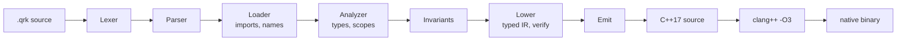

# Quark

Quark is a language for working with data. It aims to be as quick to write as
a scripting language and to run like compiled code: the compiler is written in
Go, translates each program to C++17 and builds a standalone native binary.

## Contents

- [What Quark is](#what-quark-is)
- [Quickstart](#quickstart)
- [How a program is built](#how-a-program-is-built)
- [Language tour](#language-tour)
  - [Values, variables and types](#values-variables-and-types)
  - [Printing and input](#printing-and-input)
  - [Operators](#operators)
  - [Strings](#strings)
  - [Conditions and truthiness](#conditions-and-truthiness)
  - [`if`, the ternary and `when`](#if-the-ternary-and-when)
  - [Loops](#loops)
  - [Functions](#functions)
  - [Function values and closures](#function-values-and-closures)
  - [Pipes](#pipes)
  - [Results: `ok` and `err`](#results-ok-and-err)
  - [Lists](#lists)
  - [Dicts](#dicts)
  - [Vectors](#vectors)
  - [Structs](#structs)
  - [Modules and imports](#modules-and-imports)
- [Builtin reference](#builtin-reference)
- [Standard library modules](#standard-library-modules)
- [Native code](#native-code)
- [Editor support](#editor-support)
- [Command-line reference](#command-line-reference)
- [Project layout](#project-layout)
- [Status](#status)
- [Troubleshooting](#troubleshooting)
- [Further reading](#further-reading)
- [License](#license)

## What Quark is

Developer productivity and execution speed are equal goals. You write short,
untyped code; the compiler works out the types and checks as much as it can
before the program runs.

**Types are inferred, annotations are optional.** The compiler infers the type
of every variable, list, dict and function result it can. It checks argument
types, the element type of every list and dict, return types, how a function
calls the functions passed to it, and every name across files. None of these
mistakes needs an annotation to be caught (saved as `ov.qrk`, `quark check ov.qrk` reports):

```quark
prices = list [12.5, 3.0]          // inferred: a list of float
prices.push('n/a')

fn apply(k, v) -> k(v)
fn add(a, b) -> a + b
print(apply(add, 1))

fn mean(xs) float ->
    if len(xs) > 0:
        sum(xs) / len(xs)
```

```text
error[QK-CHECK-001] (check): cannot add str to list[float]: a list keeps the element type it was created with; create it as 'xs: list = list [...]' to hold mixed values at ov.qrk:2:13
error[QK-CHECK-001] (check): argument 1 of 'apply' is called with 1 argument (line 4), but 'add' takes 2 arguments at ov.qrk:6:13
error[QK-CHECK-001] (check): function 'mean' declares return type 'float' but can end without a value (an if without else, or a when with no matching arm, returns null); give every branch a value at ov.qrk:8:1
```

**Runtime checks are the backstop.** Some values have no type the compiler can
know: an unannotated parameter, a value typed `any`, a value from native code
or from data read at runtime. Those are checked when they are used, and a
mismatch stops the program with a message and a source location. The same
`push` through an unannotated function fails at the write:

```quark
fn add_row(rows, r) -> rows.push(r)
prices = list [12.5, 3.0]
add_row(prices, 'n/a')
// runtime error: push() can't add a str to a list of float: a list keeps the element type it was created with ...
```

The goal is that a program that compiles runs as intended, and a wrong
program fails loudly instead of giving a wrong answer. The compiler doesn't
reach that everywhere yet: the known cases are listed under "Known issues" at
the top of [changelog.md](changelog.md).

**Typed code compiles to plain C++.** Variables the compiler has typed `int`,
`float` or `bool`, and that no closure captures, are C++ `long long`, `double`
and `bool`, and arithmetic on
them is native (int arithmetic is overflow-checked: overflow is a runtime
error, never a wrap). A `fn` declaration that captures no variables is a plain
C++ function called directly; one whose parameters and return type are all
annotated also gets a native C++ signature. A `vec` is a typed column in the
Apache Arrow memory layout, and arithmetic on it runs over the whole column.
Memory is managed by the Boehm garbage collector. There is no interpreter or VM.

**Tables are next.** A typed, columnar table type (`tbl[Employee]`) with a
query syntax (`staff | e -> filter(e.salary > 100.0) | group_by(e.dept) | ...`)
is the planned centrepiece for data wrangling
([tables_v0_1_spec.md](tables_v0_1_spec.md)). Its runtime
engine and CSV reader exist; the compiler side does not, so `tbl` can't be
used in a program yet.

> **Maturity.** Quark is early and changes often. Large parts of the compiler
> were written with AI assistance; use it at your own risk, and please file
> issues for bugs. Every code sample in this README was run against the
> current compiler.

## Quickstart

### 1. Prerequisites

| Tool | Why | Check |
|---|---|---|
| Go 1.21+ | builds the compiler | `go version` |
| `clang++` (C++17) | compiles the generated C++; **`g++` is not supported** | `clang++ --version` |
| CMake | only on platforms without a prebuilt garbage collector | `cmake --version` |

The Boehm garbage collector is vendored under `deps/bdwgc` as headers plus
prebuilt static libraries for Linux (x86_64, arm64), macOS (arm64) and Windows
(x86_64). On any other platform, fetch its source as described in
`deps/bdwgc/VENDORED.md`; the first `build`/`run` then builds it with CMake,
once.

### 2. Build the compiler

```bash
cd src/core/quark
go build -o quark .
```

Keep the binary in `src/core/quark`: it finds the C++ runtime headers
(`./runtime/include`), the standard library (`../stdlib`) and the garbage
collector (`../../../deps/bdwgc`) relative to itself. See
[Troubleshooting](#troubleshooting) if you move it.

### 3. Run a program

Create `hello.qrk`:

```quark
print('Hello, Quark!')
```

```bash
./quark run hello.qrk
```

```text
Hello, Quark!
```

`quark run` compiles to a temporary binary and runs it. The first run also
builds a precompiled runtime header, cached in your user cache directory (for
example `~/.cache/quark/pch`), so it takes longer. `./quark hello.qrk` is
shorthand for `./quark run hello.qrk`. The bundled examples are in
`src/testfiles`, for example `./quark run ../../testfiles/smoke_syntax.qrk`.

## How a program is built



The loader reads every included file and resolves every name, the analyzer
infers and checks types, the invariants stage checks the analyzer's output
for compiler bugs, lowering turns the program into a typed IR that is
verified on every compile, and the emitter prints it as one C++ translation
unit. Errors from
any stage carry a stable code (`QK-PARSE-001`, `QK-LOAD-001`, `QK-CHECK-001`,
`QK-RUNTIME-001`, ...; see [error_codes.md](error_codes.md)). Each stage can be
inspected with `quark lex`, `parse`, `check` and `emit`.

## Language tour

Put any snippet in a `.qrk` file and run it with `quark run`. Blocks are
indentation-based, and `//` starts a comment (there are no block comments).

### Values, variables and types

```quark
count = 3
name = 'Ada'
ratio = 0.75
done = false
nothing = null
```

The value types are `int` (64-bit), `float`, `str`, `bool`, `null`, `list`,
`dict`, `vec`, `result`, structs, functions and `resource` (a native handle,
such as an open file). Float literals may use an exponent (`1e3`, `2.5e-4`).
Floats print in their shortest exact form and keep `.0` on whole numbers:
`4.0`, `1e+16`, and `0.30000000000000004` for `0.1 + 0.2`.

**A variable keeps the type of its first value.** `x = 5`, then `x = 'a'`, is a
compile error (`cannot assign value of type 'str' to 'int'`). An int assigned
to a float variable becomes a float (`x = 1.5`, then `x = 2`, prints `2.0`).
A variable whose first value has no known type (for example the result of an
unannotated function) stays untyped; it never narrows to the type of a later
value.

**Annotations** are optional: `name: Type = expr`. They state a type the
compiler checks at compile time, or at runtime when the value's type isn't
known there (`variable 'n' is declared int but got str`). That also makes a
typed variable out of an untyped value. `any` holds values of any type:

```quark
age: int = 36
x: any = 5
x = 'five'
print(x)          // five
```

The annotation names are `int`, `float`, `str`, `bool`, `any`, `list`, `dict`,
`vec`, `result`, `resource`, `fn` (any function value) and struct names
(`Customer`, `geo::Point`). There are no element types in annotations yet
(`list[int]` is a parse error; `list[T]` and `tbl[T]` are planned). There are
no nullable types: only struct and `resource` annotations (and `any`) accept
`null`.

### Printing and input

`print(value)` writes the value and a newline. Up to four more arguments set
the line end, a minimum width, the alignment (`'left'`, `'right'`,
`'center'`) and the pad character:

```quark
print('no newline', '')
print('|')                         // no newline|
print(42, '\n', 8, 'right', '.')   // ......42
```

`print` and `to_str` show a collection's contents. Strings inside it are
quoted, dict keys are sorted, and a collection of more than 100 items shows
its first and last 5 (`fmt::full(x)` from `std/fmt` shows everything):

```quark
print(list [1, 'a', null])              // [1, 'a', null]
print(dict {name: 'Ada', age: 36})      // {age: 36, name: 'Ada'}
print(range(1000))                      // [0, 1, 2, 3, 4, ..., 995, 996, 997, 998, 999] (1000 items)
print(ok 5)                             // ok 5
```

`input()` / `input(prompt)` reads one line and returns a result: `ok(line)`
without the line ending, or `err('end of input')` once stdin is exhausted. To
read stdin to the end:

```quark
while true:
    r = input()
    if is_err(r):
        break
    print(unwrap(r).upper())
```

### Operators

From lowest to highest precedence:

| Level | Operators |
|---|---|
| 1 | `=` (assignment, a statement) |
| 2 | `\|` (pipe) |
| 3 | `a if cond else b` |
| 4 | `or` |
| 5 | `and` |
| 6 | `==` `!=` |
| 7 | `<` `<=` `>` `>=` |
| 8 | `+` `-` |
| 9 | `*` `/` `%` |
| 10 | unary `!` `-` |
| 11 | `**` (right-associative) |
| 12 | postfix `.` `[]` `()` |

```quark
print(1 + 2 * 3)      // 7
print(2 ** 3 ** 2)    // 512
print(-2 ** 2)        // -4: ** binds tighter than unary minus
print((-2) ** 2)      // 4
print(7 / 2)          // 3.5: / always gives a float
```

`a = b = 1` is a compile error. `==` compares lists, dicts and results by
value (`list [1, 2] == list [1, 2]` is `true`); on vectors it compares element
by element and gives a `vec[bool]`. Strings order by bytes with `<`, `>`, ...

### Strings

Strings use single or double quotes, with the escapes `\\`, `\'`, `\"`, `\n`,
`\t` and `\r`. A string can't contain a NUL character, so `\0` is a compile
error. `+` joins two strings only; convert other values with `to_str`. Methods
chain:

```quark
print('  Quark  '.trim().upper())           // QUARK
print('hello world'.split(' ').join('-'))   // hello-world
print('abcdef'.slice(1, 4))                 // bcd
print('n = ' + to_str(3))                   // n = 3
```

### Conditions and truthiness

`if`, `while`, `and`, `or`, `!` and the ternary accept most values by
truthiness (`0`, `''`, `null` and empty collections are false). `and`/`or`
short-circuit and return one of their operands (`0 or 'fallback'` is
`'fallback'`); `!` returns a `bool`. There is no `not` keyword.

Results and vectors have no truthiness: using one as a condition is an error.
Check a result with `is_ok`, `is_err` or `when`, and reduce a vector
comparison with `all` or `any`:

```quark
a = vec [1, 2, 3]
b = vec [1, 0, 3]
if all(a == b):
    print('same')
else:
    print('different')   // different
```

### `if`, the ternary and `when`

```quark
fn classify(n) ->
    if n < 0:
        'negative'
    elseif n == 0:
        'zero'
    else:
        'positive'

print(classify(10))                   // positive
x = 7
print('big' if x > 5 else 'small')    // big
```

`when` matches a value against literals, or-patterns, `_` and result patterns
(`ok v` / `err e`), in order. It is an expression:

```quark
n = 2
size = when n:
    0 -> 'none'
    1 or 2 -> 'few'
    _ -> 'many'
print(size)           // few
```

An `if` without `else`, or a `when` without a matching arm, has no value
(`null`), and the compiler takes that into account.

### Loops

`for` iterates over a `list`, `vec` or `str`. `range(end)`,
`range(start, end)` and `range(start, end, step)` give a list of ints.
`while` repeats while its condition is true. `break` and `continue` work in
both; outside a loop they are compile errors.

```quark
total = 0
for i in range(1, 6):
    total = total + i
print(total)          // 15
```

### Functions

`fn` declares a function. Parentheses are required; the body is one
expression after `->`, or an indented block whose last expression is the
result. Quark has no `return`.

```quark
fn add(x, y) -> x + y

fn abs_diff(a, b) ->
    if a > b:
        a - b
    else:
        b - a

print(abs_diff(3, 8)) // 5
```

**Annotations** on parameters and the return type (between `)` and `->`) are
each checked on their own, at compile time when the types are known, and on
entry or on return otherwise. An int passed to a `float` parameter becomes a
float:

```quark
fn scale(x: float, k) -> x * k
print(scale(1, 2))    // 2.0
fn greet(name: str) str -> 'Hello, ' + name
```

A body that can end without a value under a return annotation is a compile
error (see the example in [What Quark is](#what-quark-is)). An unannotated
parameter accepts any value; misuse inside the body (`x.upper()` on an int)
is a runtime error.

**Default parameters** are literals (a number, string, bool, `null`, a negated
number or an empty `list []`) and follow the required parameters. A literal
default also types its parameter (`n = 1` makes `n` an int):

```quark
fn add_n(x, n = 1) -> x + n
print(add_n(5))       // 6
print(add_n(5, 10))   // 15
```

**Declarations are fixed and hoisted.** Every `fn` of a scope (the file, a
module body or a block) exists before the scope's first statement, so
functions can be called above their definition and can call each other in any
order:

```quark
print(is_even(10))     // true

fn is_even(n) ->
    if n == 0:
        true
    else:
        is_odd(n - 1)

fn is_odd(n) ->
    if n == 0:
        false
    else:
        is_even(n - 1)
```

A declared name can't be declared twice in a scope, assigned, or reused by a
nested `fn` while it is visible. Parameters, loop variables and `when`
bindings may shadow outer names, including builtins (`fn clamp(x, min, max)`).
Builtins themselves can't be redefined or assigned (`sum = 0` is an error).

Variables are not hoisted: a function sees only the variables assigned above
it. Calling a function before a variable it uses is assigned is a compile
error when the call is visible, and a runtime error through a function value:

```quark
report()               // error: 'report' uses 'total', which is assigned on line 2, after this call
total = 5
fn report() -> print(total)
```

### Function values and closures

Named functions, lambdas (`fn(params) -> expr`), `extern fn`s and module
members (`io::exists`) are values that can be stored, passed and returned. A
lambda captures the variables it uses from the enclosing scope, by reference:

```quark
base = 100
bump = fn(x) -> x + base
print(bump(5))           // 105

fn make_adder(n) -> (fn(x) -> x + n)
add5 = make_adder(5)
print(add5(10))          // 15
```

A lambda directly after `->` must be in parentheses, as above.

A variable holding a function keeps its signature (`g = fn() -> 5`, then
`g = fn() -> 'abc'` is an error); `g: fn = ...` holds any function. The `fn`
annotation means any function value, with no signature, and doesn't accept
`null`:

```quark
inc = fn(x) -> x + 1
fn apply(f: fn, x: int) -> f(x)
print(apply(inc, 1))            // 2
print(apply(fn(v) -> v * 2, 4)) // 8
```

The compiler records how a function calls its parameters and checks each
function passed in against that, also when the parameter is passed on to
another function:

```quark
fn apply(k, v) -> k(v)
apply(fn(x: int) -> x, 'one')
// error: argument 1 of 'apply' is called with str as argument 1 (line 1), but the lambda passed expects int
```

When the compiler can't know which function a value holds (it came from
`any`, a struct field or native code), the call checks the argument count at
runtime (`function 'h' expects 1-2 arguments but got 0`) and fills in default
arguments.

### Pipes

`x | f(a)` is exactly `f(x, a)`, and `x | obj.m(a)` is `obj.m(x, a)`. The
target must be a call.

```quark
inc = fn(x) -> x + 1
5 | inc() | print()              // 6
'hello'.upper() | print()        // HELLO
```

### Results: `ok` and `err`

Recoverable failure is a value, not an exception. Build results with
`ok expr` / `err expr` and take them apart with `when`:

```quark
fn safe_div(a, b) ->
    if b == 0:
        err 'division by zero'
    else:
        ok (a / b)

when safe_div(10, 0):
    ok value -> print(value)
    err msg  -> print(msg)       // division by zero
```

`is_ok(r)`, `is_err(r)` and `unwrap(r)` (a runtime error on `err`) are the
helpers. A result is never `null`: `r == null` is a compile error.

### Lists

A list is an ordered, growable container (`list` is required in the
literal). Index with `[]`; negative indices count from the end.

```quark
nums = list [3, 1, 2]
nums.push(4)
print(len(nums))                  // 4
print(nums[-1])                   // 4
print(nums.get(10))               // null: .get returns null out of range
// nums[10] is a runtime error: list index 10 out of range (list length 4)
nums[0] = 9
print(nums.sort())                // [1, 2, 4, 9]
```

**A list keeps the element type it was created with**, through every name for
it: `nums.push('five')` above is a compile error, and a write from code the
compiler can't check (an unannotated function, a value from `any`) is checked
at runtime. A list of mixed literals (`list [1, 'a']`) holds both types. To
hold any value, create the list under a `list` annotation:

```quark
row: list = list ['Pune', 31.5]
row.push(true)
print(row)                        // ['Pune', 31.5, true]
```

An empty `list []` takes its element type from its first write, so an
accumulating loop builds a typed list:

```quark
squares = list []
for i in range(4):
    squares.push(i * i)
print(squares)                    // [0, 1, 4, 9]
```

An int written into a list of floats is stored as a float. Changing a list
while a `for` loop runs over it isn't checked yet (see Known issues). The
methods are in the [method table](#methods).

### Dicts

A dict maps keys to values. Keys in a literal are bare identifiers.

```quark
user = dict { name: 'ada', city: 'paris' }
print(user.name)                  // ada
user.city = 'london'
user.set('lang', 'en')            // sets in place and returns the dict
print(user.get('age'))            // null: .get returns null for a missing key
print(user)                       // {city: 'london', lang: 'en', name: 'ada'}
```

`d.key` on a missing key is a runtime error (`dict has no key 'age'; use
.get('age') if the key may be missing`), since it is usually a typo.
`d['key']` is not supported; use `d.key`, `.get` and `.set`. A `for` loop
can't iterate a dict directly; use `.keys()`, `.values()` or `.items()`.

**A dict keeps its value type**, like a list: `user.age = 36` above is a
compile error, and untyped code writing a wrong-typed value is a runtime
error. `d: dict = dict { ... }` holds any value, and an empty `dict {}` takes
its value type from its first write.

### Vectors

A `vec` is one typed column: all `int` (`vec[i64]`), `float` (`vec[f64]`),
`bool` or `str`. Arithmetic and comparisons apply to every element, a
`vec[bool]` filters another vector, and every operation returns a new vector
(vectors can't be changed in place):

```quark
temps = vec [31.5, 29.0, 33.1, 38.2]
print(type(temps))                // vec[f64]
f = temps * 1.8 + 32.0            // element-wise, no loop
hot = temps[temps > 30.0]         // filter with a mask
print(hot)                        // [31.5, 33.1, 38.2]
print(max(hot))                   // 38.2
print(sum(vec [1, 2, 3]))         // 6
```

A vector may have missing values. A `vec` literal can't contain `null`, so
build one from a list: `list [1, null, 3].to_vec()`. Arithmetic skips missing
slots, `fillna(v)` replaces them, `drop_na()` removes them, and reductions skip
them. Taking a missing element out as one value (`v[i]`, `for x in v`) is a
runtime error that names `fillna` and `drop_na`.

`sum`, `min` and `max` of a vector follow the table aggregates: an int vector
sums exactly to an int, `min`/`max` keep the element type, and missing entries
and NaN are skipped. `min`/`max` of a vector with no present values is an
error. The mean is `stats::mean` from `std/stats`.

The buffers use the Apache Arrow columnar layout: contiguous `int64`/`double`
values, bit-packed bools, `int32` offsets plus UTF-8 bytes for strings, a
validity bitmap only when there are nulls, all 64-byte aligned on the GC heap.
Native code can use a vector's memory directly; `std/blas` hands it straight
to OpenBLAS.

### Structs

A struct is a fixed-shape record with typed fields and optional defaults
(constant expressions):

```quark
struct Customer:
    id: int
    name: str
    age: int = 0
    city: str

c = Customer { id: 1, name: 'Alice', city: 'NYC' }
print(c.age)        // 0
print(c)            // Customer {id: 1, name: 'Alice', age: 0, city: 'NYC'}
older = Customer { id: c.id, name: c.name, age: c.age + 1, city: c.city }
print(older.age)    // 1
```

A literal may also span lines, one field per line. Missing, unknown and
duplicate fields and wrong field types are compile errors; a value of unknown
type is checked when the struct is built (`field 'id' of Customer expects int,
got str`), and an int going into a `float` field becomes a float. Structs are
immutable (`c.age = 2` is an error; build a new one) and have no methods or
`==` (compare fields). A struct-typed field may be `null`.

### Modules and imports

A file is the unit you import, and each file has its own names. Names from
another file or from a `module` block are always written with `::`; nothing
from another file is visible unqualified.

```quark
module mathx:
    fn square(x) -> x * x
    fn quad(x) -> square(square(x))   // members call each other bare

print(mathx::quad(2))     // 16
```

`incl 'path'` binds a file under its name (the last path segment, without
`.qrk`); `incl 'path' as other` picks another name. Its top-level names are
`file::name`, members of its modules `file::module::name`, and members of a
module named like the file (its *primary* module) are also `file::name`:

```quark
// lib/geo.qrk
PI = 3.14159
struct Point:
    x: float
    y: float
fn area(r) -> PI * r * r
module shapes:
    fn square(side) -> side * side
```

```quark
incl './lib/geo'

p = geo::Point { x: 1.0, y: 2.0 }
fn norm(q: geo::Point) float -> q.x * q.x + q.y * q.y
print(geo::area(2.0))           // 12.56636
print(geo::shapes::square(3))   // 9
print(type(p))                  // geo::Point
```

The rules:

- Two files may define the same name; `geo::Point` and `other::Point` are
  different types. Within one file, a name defined twice, a module member
  named like a top-level name, or an import named like a definition is a
  compile error.
- An imported file may contain only definitions: `fn`, `struct`, `module`,
  `incl`, `extern` declarations and constants (`PI = 3.14159`: scalar
  literals and arithmetic on them). Any statement is a load error, so
  importing never runs code. An importer can use every name of the file
  (there are no access modifiers) but can't assign to it.
- `.` is for values: `io.exists` is an error that suggests `io::exists`.
- Names can't contain `__` (reserved for generated names). Imported file
  names and directories in import paths are lowercase letters, digits and
  `_`, starting with a letter.

Standard library modules are imported with the `std/` prefix:

```quark
incl 'std/fmt'
incl 'std/io'

print(io::exists('hello.qrk'))           // true or false
print(fmt::full(range(200)))             // every item, nothing elided
exists = io::exists                      // a member as a value
```

## Builtin reference

These are available everywhere without an import. The source of truth for
names, arities and types is `src/core/quark/builtins/catalog.go`.

| Function | Args | Returns | Notes |
|---|---:|---|---|
| `print` | 1-5 | | value, then optional `end` (default `'\n'`), width, align, pad |
| `input` | 0-1 | result | `ok(line)`, or `err('end of input')` |
| `len` | 1 | int | str, list, dict or vec |
| `to_str`, `to_int`, `to_float`, `to_bool` | 1 | | conversions; an unparseable string is a runtime error |
| `type` | 1 | str | runtime type name (`int`, `list`, `vec[i64]`, `Customer`, `geo::Point`) |
| `is_ok`, `is_err` | 1 | bool | test a result |
| `unwrap` | 1 | | the value of an `ok`; runtime error on `err` |
| `range` | 1-3 | list | `range(end)`, `range(start, end)`, `range(start, end, step)` |
| `abs` | 1 | | keeps int or float |
| `min`, `max` | 1-2 | | of two numbers, or of one numeric vector (float) |
| `sum` | 1 | float | of a numeric or bool vector (not a list) |
| `sqrt` | 1 | float | runtime error on a negative number |
| `floor`, `ceil`, `round` | 1 | int | |
| `all`, `any` | 1 | bool | of a `vec[bool]`, skipping nulls |

### Methods

| Receiver | Method | Does |
|---|---|---|
| `str` | `.upper()`, `.lower()`, `.trim()` | new string |
| | `.contains(s)`, `.startswith(s)`, `.endswith(s)` | bool |
| | `.replace(old, new)` | replaces every occurrence |
| | `.split(sep)` | list of str |
| | `.slice(start, end)` | substring `[start, end)` |
| `list` | `.push(x)` | appends in place, returns the list |
| | `.pop()`, `.remove(i)` | removes and returns the last item / item `i` |
| | `.get(i)` | item `i`, or `null` out of range (type `any`; `xs[i]` errors out of range) |
| | `.set(i, x)`, `.insert(i, x)` | in place |
| | `.slice(start, end)`, `.concat(other)` | new list |
| | `.reverse()`, `.sort()`, `.sort_by(key)` | in place, returns the list; sorts are stable and ascending, keys all numbers, all strings or all bools (`rows.sort_by(fn(r) -> r.amount)`) |
| | `.join(sep)` | one string |
| | `.enumerate()` | list of `{index, value}` dicts |
| | `.to_vec()` | typed vector (elements must be one scalar type, or `null`) |
| `dict` | `.get(key)` | value, or `null` if missing (type `any`; `d.key` errors if missing) |
| | `.set(key, x)` | sets in place, returns the dict |
| | `.keys()`, `.values()`, `.items()` | lists (`items` gives `{key, value}` dicts) |
| `vec` | `.get(i)` | element `i`, or `null` for a missing entry (type `any`); runtime error out of range |
| | `.fillna(x)` | new vector with missing values replaced |
| | `.astype(dtype)` | new vector of dtype `'i64'`, `'f64'` or `'bool'` |
| | `.to_list()`, `.enumerate()` | lists |

When a receiver's type isn't known at compile time (for example the result of
`unwrap`), the method is chosen at runtime, and a receiver without that method
is a runtime error (`type 'int' has no method 'upper'`). Behavior details are
in [stdlib.md](stdlib.md).

## Standard library modules

Each module lives in `src/core/stdlib` and is imported with `incl 'std/name'`,
which binds `name`.

| Module | Functions |
|---|---|
| `io` | `io::open(path, mode = 'r', binary = false)`, `io::read(f, n)`, `io::write(f, s)`, `io::close(f)`, `io::seek(f, offset, whence = 0)` (all return results), `io::exists(path)`, and `io::seek_set()`/`seek_cur()`/`seek_end()` |
| `fmt` | `fmt::show_list`, `fmt::show_vec`, `fmt::show_dict`, `fmt::table` (a dict of columns), `fmt::head`, `fmt::tail`, `fmt::full` |
| `sys` | `sys::args()` (arguments after `--`), `sys::env(name)` (`null` if unset), `sys::exit(code = 0)` |
| `time` | `time::now()` (epoch seconds), `time::clock()` (monotonic seconds), `time::sleep(seconds)` |
| `random` | `random::seed(n)`, `random::uniform()`, `random::randint(lo, hi)` (both ends included), `random::choice(xs)`, `random::shuffle(xs)` |
| `csv` | `csv::parse(text, sep = ',')`, `csv::read(path, sep = ',')`: rows as lists of `str` |
| `blas` | `blas::dot`, `axpy`, `scal`, `nrm2`, `asum`, `gemv` on `vec[f64]` via OpenBLAS (needs `libopenblas-dev` or `brew install openblas`) |

The current `std/csv` will be replaced when tables land, by a reader that
returns typed tables (`csv::read_file`). A module's native bindings are
reachable too (`fmt::fmt_vec`), but its functions are the intended API.

## Native code

`extern 'file.hpp'` includes a C++ header (relative to the `.qrk` file), and
`extern fn` binds a function in it, with the same parameter rules as Quark
functions:

```cpp
// mylib.hpp
#include <cstdint>
inline int64_t my_add1(int64_t x) { return x + 1; }
```

```quark
extern 'mylib.hpp'
extern fn add1(x: int) int as 'my_add1'
print(add1(41))     // 42
```

`extern link 'name'` links a native library and `extern include_path 'dir'`
adds a header directory; both apply to the whole program. Glue code uses the
`qext::` API. See [ffi_v0_1_spec.md](ffi_v0_1_spec.md) and
`src/core/stdlib/blas.qrk` for a complete example.

## Editor support

`src/devtools/vscode-extension/quark` is an extension for VS Code and
Positron: highlighting, snippets, completion, hover and a run command. It also
flags Python and R habits (`def`, `elif`, `True`, `NULL`, `&&`, `#` comments)
and says what Quark uses instead. Build it with Go only:

```bash
cd src/core/quark && go run ./cmd/quark-vsix
```

Then run **Extensions: Install from VSIX...** and pick the file it prints.

## Command-line reference

| Command | Does |
|---|---|
| `quark run <file> [-- args...]` | compile and run; arguments after `--` go to the program |
| `quark build <file> [-o out]` | compile to an executable |
| `quark <file>.qrk` | shorthand for `quark run` |
| `quark check <file>` | parse, load and analyze; report diagnostics only |
| `quark emit <file>` | print the generated C++ |
| `quark lex <file>`, `quark parse <file>` | print the tokens / the AST |
| `quark help` | usage |

| Flag (`build`, `run`) | Effect |
|---|---|
| `-o <name>` | output name (`build`) |
| `--debug`, `-d` | print the compile and link commands and keep the generated C++ (`run` also keeps the executable next to the source) |
| `--lto` | link-time optimization |
| `--no-pch` | don't use the cached precompiled runtime header |
| `--lib-path <dir>` | search `<dir>` for `extern link` libraries and add it to the rpath (repeatable) |
| `--include-path <dir>` | add a C++ include directory (repeatable) |
| `--link-arg <arg>` | pass an argument to the linker (repeatable) |

`QUARK_LIB_PATH` and `QUARK_INCLUDE_PATH` (path lists) work like the two path
flags. Errors fail the command with a non-zero exit code; warnings are shown
and don't. An `INV-*` diagnostic is a compiler bug.

## Project layout

| Path | Contents |
|---|---|
| `src/core/quark` | the Go compiler (`main.go` is the CLI) |
| `.../lexer`, `parser`, `loader`, `types`, `invariants`, `lower`, `emit` | the compiler stages (`types` is the analyzer, `lower` builds and verifies the IR, `emit` prints C++) |
| `.../driver`, `toolchain` | run the stages in order; find clang++, the runtime and the GC, compile and link |
| `.../ast`, `token`, `names`, `ir`, `builtins`, `diagnostics` | shared data: AST, tokens, the name table, call-plan and storage IR, the builtin catalog, diagnostics |
| `.../runtime/include/quark` | the header-only C++17 runtime, including the table engine and CSV reader (`table/`) |
| `.../cmd/quark-vsix`, `internal/` | the extension packager; editor data generation and test helpers |
| `src/core/stdlib` | standard library modules (`.qrk`, most with a `.hpp` of native code) |
| `src/testfiles` | example and test programs (`smoke_*.qrk`) |
| `src/benchmarks` | the benchmark suite against Python and R (`bench.py`; see its `README.md`) |
| `src/devtools/vscode-extension/quark` | the editor extension |
| `deps/bdwgc` | the vendored Boehm GC (see `VENDORED.md`) |

## Status

**Planned:**

- Tables: the `tbl[T]` type, queries, a typed CSV reader
  ([tables_v0_1_spec.md](tables_v0_1_spec.md)).
- Element types in annotations: `list[T]`.
- Struct methods and whole-struct equality.
- Result helpers such as `unwrap_or` and `map_ok`.
- `extern source` (separately compiled C++ files; today it is a parse error).

**Known limitations** (deliberate gaps, not bugs):

- No regex, JSON, HTTP, subprocesses or dates. Vectors have no sort
  (`v.to_list().sort()` works).
- No annotation for "any struct" (`fn f(x: struct)` is a parse error; use
  `any`), and no nullable types.
- A struct field holding a function can't be called directly: with `run: fn`,
  `h.run(4)` is a compile error; bind it first (`r = h.run`, then `r(4)`).
- An unannotated parameter's type isn't inferred from how the body uses it
  (only from how it calls it), so `fn f(x) -> x.upper()` called with an int is
  a runtime error, not a compile error.
- A pipe continued on the next line (`| f()`) must have the same indentation
  as the line before it.
- A `vec` literal can't contain `null`.

**Known issues.** Bugs, including the cases where the compiler still gives a
wrong result without an error, are listed with reproductions under "Known
issues" at the top of [changelog.md](changelog.md).

## Troubleshooting

**`Error: clang++ not found in PATH`**: install clang (`sudo apt install
clang`, or `brew install llvm`). `g++` is not supported.

**`no prebuilt Boehm GC library for <os>/<arch> ... and no GC source to build
one`**: your platform has no prebuilt GC. Fetch the GC source as described in
`deps/bdwgc/VENDORED.md` and install CMake; the next build compiles it once.

**`Boehm GC is not built and cmake is not available`**: install CMake.

**Imports, runtime headers or the GC not found**: keep the binary in
`src/core/quark`. Otherwise:

- Standard library: `QUARK_STDLIB_ROOT` if set, else a `stdlib/` directory in
  the source file's directory or any parent, else `stdlib/`, `../stdlib` or
  `../../stdlib` next to the binary. An unrelated `stdlib/` directory above
  your program is picked up first; set `QUARK_STDLIB_ROOT` to avoid that:
  `export QUARK_STDLIB_ROOT=/abs/path/to/src/core/stdlib`.
- Runtime headers: `runtime/include` next to the binary, else in the current
  directory.
- GC (`could not locate deps/bdwgc`): `../../../deps/bdwgc` or `deps/bdwgc`
  next to the binary, else `deps/bdwgc` in the current directory or a parent.

**`QK-FFI-002`: native library not found**: a module asked for a library with
`extern link` (`std/blas` needs OpenBLAS). Install it, or pass its directory
with `--lib-path` or `QUARK_LIB_PATH`. The error lists the directories
searched.

**`QK-FFI-003`: C++ error in extern glue code**: clang's message above it
shows the problem. `'foo.h' file not found` usually needs `--include-path`.

## Further reading

- [grammar.md](grammar.md): syntax and the formal grammar.
- [semantics.md](semantics.md): runtime behavior, truthiness, the error model.
- [stdlib.md](stdlib.md): builtin and module behavior.
- [architecture.md](architecture.md): compiler and runtime internals.
- [error_codes.md](error_codes.md): diagnostic codes.
- [changelog.md](changelog.md): what changed, and the known issues.
- [src/benchmarks/README.md](src/benchmarks/README.md): performance against
  Python (NumPy, pandas, Polars) and R (base, data.table), and how it is
  measured.
- Design specs: [modules_v0_2_spec.md](modules_v0_2_spec.md),
  [structs_v0_1_spec.md](structs_v0_1_spec.md),
  [tables_v0_1_spec.md](tables_v0_1_spec.md),
  [ffi_v0_1_spec.md](ffi_v0_1_spec.md),
  [stdlib_expansion_v0_1_spec.md](stdlib_expansion_v0_1_spec.md) (a draft).

If a doc disagrees with the compiler, the compiler is right; please report
the difference.

## License

GNU General Public License v3.0; see `LICENSE`. Third-party dependencies have
their own licenses (for example `deps/bdwgc/LICENSE`).
